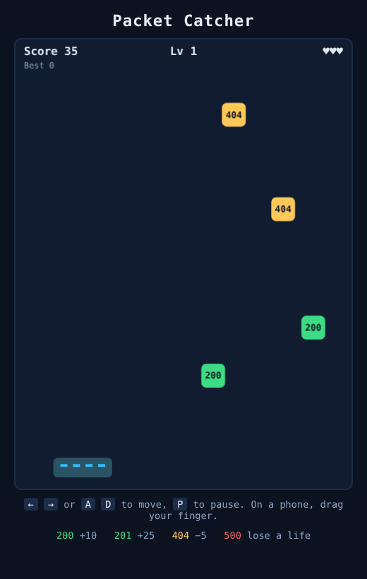

# Packet Catcher

[](https://github.com/ducampcarlos/packet-catcher/actions/workflows/ci.yml)
[](LICENSE)

**A tiny server-themed arcade game for the browser: catch the `200`s, dodge the `500`s.**
No frameworks, no build step, no dependencies. Just HTML5 canvas and ES modules.



## How to play

You are a server rack at the bottom of the screen. Responses fall from the top:

| Packet | Effect |
| --- | --- |
| `200` | +10 points |
| `201` | +25 points (rare) |
| `404` | −5 points |
| `500` | lose a life |

Every 10 good catches the level goes up: packets fall faster and arrive more often. Three lives. Your best score is stored in your browser.

**Controls:** `←` `→` or `A` `D` to move, `P` to pause, `Enter` to restart. On a phone or with a mouse, press and drag.

## Run it locally

```bash
git clone https://github.com/ducampcarlos/packet-catcher.git && cd packet-catcher
npm start            # serves http://localhost:8000 with python3 -m http.server
npm test             # unit tests (Node 20+)
```

ES modules need an HTTP server, so opening `index.html` straight from disk won't work in most browsers.

## Play online (GitHub Pages)

In the repository **Settings → Pages**, choose *Deploy from a branch → main → / (root)*. The game is then served at `https://<user>.github.io/packet-catcher/`.

## How it's built

```
src/game.js   pure game logic: step(state, dt, input). No DOM, no timers, no Math.random
src/main.js   canvas rendering, keyboard/pointer input, requestAnimationFrame loop
test/         node:test unit tests for the logic
```

The logic is deliberately separated from the rendering. `step()` takes the elapsed time and the input and returns the new state, and the random number generator is injected, so the tests can replay a game from a seed and get exactly the same result. The render loop clamps the frame time so a background tab can't make packets tunnel through the rack.

## License

MIT, see [LICENSE](LICENSE). Copyright (c) 2026 Carlos Ducamp.
